

  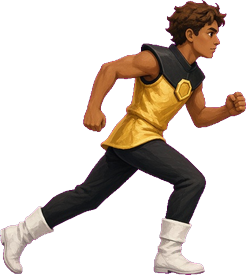
  &nbsp;&nbsp;&nbsp;
  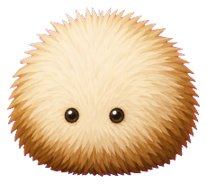

<h1 align="center">AMBER RUN</h1>

  <strong>How the deck thinks.</strong> 
  An endless simulation-deck runner. You do not change levels. You survive them. 
  Three clean hits end you. Everything else is a rule with a switch.

  <code>3 lives</code>
  &nbsp;·&nbsp; <code>jump the low stuff</code>
  &nbsp;·&nbsp; <code>slide the high stuff</code>
  &nbsp;·&nbsp; <code>land on struts</code>
  &nbsp;·&nbsp; <code>phone upright</code>

  

  <a href="https://youtu.be/9vQSC3qOSFU"><strong>▶ Gameplay preview</strong></a>
  &nbsp;&nbsp;·&nbsp;&nbsp;
  <a href="https://n2nhulabs.store"><strong>N2NHU Labs</strong></a>
  &nbsp;&nbsp;·&nbsp;&nbsp;
  <a href="https://n2nhulabs.store/guide"><strong>Deck logic guide</strong></a>

  Coming November 2026 on Google Play. 
  The store is the workshop. The guide is this page, alive, with the switches you can flip.

  <a href="#the-run">The run</a>
  &nbsp;·&nbsp; <a href="#three-hits">Three hits</a>
  &nbsp;·&nbsp; <a href="#when-you-cannot-die">Cannot die</a>
  &nbsp;·&nbsp; <a href="#the-medic">Medic</a>
  &nbsp;·&nbsp; <a href="#shrink">Shrink</a>
  &nbsp;·&nbsp; <a href="#disco">Disco</a>
  &nbsp;·&nbsp; <a href="#the-dojo">Dojo</a>
  &nbsp;·&nbsp; <a href="#beast-mode">Beast</a>
  &nbsp;·&nbsp; <a href="#rockstar">Rockstar</a>
  &nbsp;·&nbsp; <a href="#phone-tricks">Phone</a>
  &nbsp;·&nbsp; <a href="#pocket-toys">Toys</a>
  &nbsp;·&nbsp; <a href="#the-cast">Cast</a>

  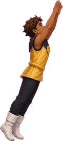
  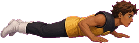
  
  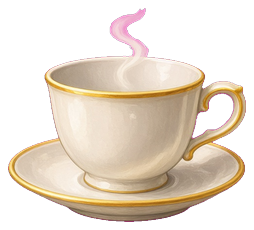
  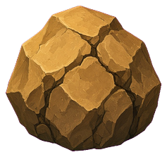
  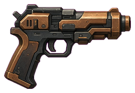
  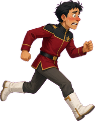
  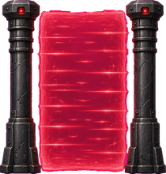
  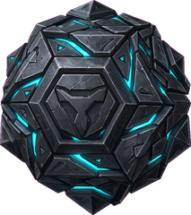
  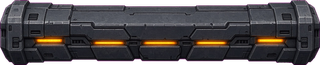
  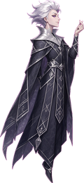
  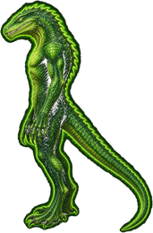
  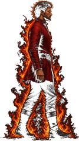
  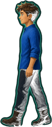
  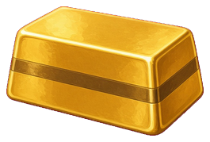
  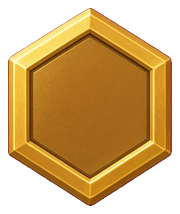
  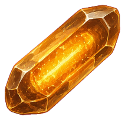
  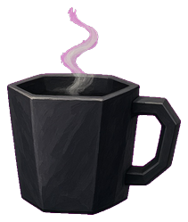

---

## The run

You run a corridor that never ends. Low hazards want you in the air. High hazards want you on the floor. A strut will accept either: slide under it, or land on top.

The deck keeps a record on the device. Combo sweetens the points you earn just for running. Pickups inside a couple of seconds of each other build that combo. A near-miss, slipping past a hazard with daylight to spare, pays **30 × combo** and dings it too.

Every **ten hazards you actually clear**, the deck pays a life back. A hit does not erase that counter. It only breaks your clean streak.

| You | What the corridor wants |
| --- | --- |
|  | Gold vest. Feet on the deck. This is the body the hitbox believes in. |
|  | Airborne. Low hazards want this version of you. |
|  | Sliding. High hazards want this version of you. |

Tap the right side, or the jump key, to leave the floor. Hold the right side, or roll the phone, to slide. In the dojo those same controls kick and slide. Keys still work if you own a keyboard in a corridor.

---

## Three hits

You start with three lives. An unprotected touch spends one. The third one does not leave you with zero and a shrug. It ends the run.

**What counts as a hit**

- A low hazard, if you do not jump it.
- A high hazard, if you do not slide under it.
- A strut you rise into from below, or meet head-on. Landing *on* a strut is allowed. You can jump off, or ride it and drop when it passes.
- The redshirt's fire.
- A dojo shove off the left edge. That whole deck starts over.

A life lost beams you out and back in. For a little over a second you flicker, and touches pass through you.

---

## When you cannot die

Armor is not a halo. Most of these still destroy the thing that touched you, still break a strut chain, and still wind down the clock if it is running.

| State | What it actually does |
| --- | --- |
| **Mercy blink** | Just rematerialized after a lost life. A little over a second of flicker. The rose beam gives a slightly longer blink, then a quiet corridor for about two seconds. |
| **Disco lock** | During the trifecta dance the scroll stops and corridor hits are not even checked. A short blink remains after the music lets go. |
| **Medic's ward** | The next **three** touches do not take a life. Then you are mortal again. |
| **Field crystal** | The next **one** hit pops the blue bubble instead of you. The hazard dies. Your streak does not survive it. |
| **Shrink pop** | The hit that breaks half-size does **not** spend a life. You just return to full size, and the clean streak resets. |
| **Mid-transport** | While the ship is pulling you apart or putting you back together, overlap does not hurt. |

**Not invincible.** The green clock pins your pace. The corridor keeps the speed you already had, and stops getting faster, until **two enemy hits** unwind it. You can still die at a very stylish constant speed.

---

## The medic

  

Blue tunic, green glow, not a red box. Touch them. The next three hits will not take a life.

Each of those three still destroys the thing that touched you, still breaks a strut chain, and still winds the clock down if it is running. When the third ward is gone, you are mortal again.

  
  &nbsp;&nbsp;&nbsp;
  

**Redshirt** walks in from the left. He is drawn half the size of a normal threat so you have a chance, except on the grey rockstar deck, where he is drawn big enough to see and ringed in white. His fire scorches. That is a normal hit unless a ward, a field, shrink, or mercy is holding.

**Lizard** is rare, tall, and green. A floor problem. Jump him. On rockstar he gets the same white ring as every other threat, so the grey boards cannot swallow him.

---

## Shrink

Clear **five hazards in a row**. No hit in between.

The deck shrinks you to about half size. Same jump. Same slide. A much ruder hitbox. You are harder to catch, which is the whole reason to want it.

The next real hit does not spend a life. It pops you back to full size, breaks the clean streak, and the hunt for five starts over.

**What breaks the streak:** a life lost, the hit that pops shrink, death. A near-miss does not. A pickup does not. Landing a strut does not. Only contact with something that wanted you dead.

Shrink is the small target. Brew is the slow world. They are not the same toy.

---

## Disco

  

A strut is the high bar. Slide under it, or jump and stand on top.

**Land on three in a row.** No misses. No hits. Every strut the deck offers has to be boarded. Letting one go by without boarding it kills the chain. Rising into one, or smacking it head-on, is a hit, and the chain dies with it.

Three boarded, and nothing else offered in between, and the scroll stops.

The screen flashes. A spotlight and a mirror ball find you. You dance, spin, finish with an up-pointing flourish and a ridiculous grin, while a midi disco loop pretends this was always the plan. Then the counter resets and the deck rolls again. Corridor hits are not checked while the deck is holding still.

---

## The dojo

You do not just change levels.

Finish a deck and the ship does **not** beam you onward yet. First the corridor pauses and the fleet overhead sways. Then you are in a circus dojo for **fifteen seconds**, barefoot, in the belt of the deck you just finished.

- **Jump is a kick.** Slide is still a slide, and it also clears the low ones.
- Objects bob in to circus midi. Kick them and they explode for points.
- Stand there like a houseplant and they shove you left.
- The far left edge spends a life and **restarts that deck from the top**. The fifteen seconds do not restart with you. Fail, and you do not skip ahead. You are one life poorer, and that deck starts over.
- Survive the whole fifteen and a robot voice calls the win. You disco. Then a ship locks on and beams you to the next deck.
- Gravity smash rearms on that beam. The new deck owes you one big kill.

The belt is the deck you just cleared.

| After | Belt | Dojo |
| --- | --- | --- |
| D-01 | White | Clean Slate |
| D-02 | Yellow | First Light |
| D-03 | Orange | Rising Sun |
| D-04 | Green | Green Growth |
| D-05 | Blue | Open Sky |
| D-06 | Purple | Twilight |
| D-07 | Brown | Earth Rank |
| D-08 | Red | Sunfire |
| D-09 | Black | True Beginning |
| D-10 on | Black, next dan | 2nd Dan, 3rd Dan, and onward |

No shoes. Feet show. Fifteen seconds. Kick, or get shoved.

---

## Beast mode

Beast wakes on **deck 04**, and it does not turn off. Later decks stay beastly.

Before that, the corridor is a parade. Things enter from the right and scroll at you. Beast retires the parade. **One hazard at a time** materializes in the open lane ahead of you, fully drawn, then slides in. You jump the low ones and slide the high ones the same as always.

Visitors still wander in on their own clocks: the medic, the redshirt, the lizard, the green pace-clock.

<code>D-01 parade</code> → <code>D-02 parade</code> → <code>D-03 parade</code> → <code>D-04 BEAST</code> → <code>forever</code>

**Don't confuse the lights.** The red-deck warning along the screen edges turns on well before beast mode, once the run is deep enough. Beast is specifically deck 4. Rockstar is a third thing, and it will not even consider you until beast is already on.

---

## Rockstar

Beast on. Then **eight hazards cleared in a row.**

The boards drop their color. Ships go grey. Stars go grey. You do not. Threats keep their pictures and grow a hard white ring, so a grey strut cannot hide in a grey wall. The redshirt is drawn larger.

  

It happens **once a run**. A hit before the eighth clear resets the streak, so rockstar can slip away. Shrink usually arrives first, at five, and if you keep the streak going the same run of clears can hand you both.

| | |
| --- | --- |
| **On** | Beast mode, and a clean streak of 8. |
| **Off** | It doesn't turn off. The grey stays. |
| **Still deadly** | The ring is a warning, not a hug. |
| **Not the red edge** | Red deck and rockstar can both be true. One is a warning light. One is the wardrobe. |

The feature is the grey room. The enemies are supposed to be obvious.

---

## Phone tricks

### Gravity smash

Hold the phone the way you play: landscape, **not flat on a table**.

A tilt toward you is a jump. A tilt the other way is a slide. A smash is ruder. **Three actual hops**, weightless then a landing shock, inside about eight seconds. Every hazard on screen vanishes. You get one smash per deck. The dojo beam to a new deck hands it back. Lying the phone flat does not count. The needle is watching the hop, not the lean.

### The rose

Turn the phone in a real circle, same direction, **three times**. A little rose on the screen fills in as you go.

Three turns and the ship beams you to the **end of this deck**, which means you still owe the dojo a belt exam. You do not get to skip the circus. After you arrive, the corridor stays calm for a couple of seconds. There's a short cooldown before the rose will listen again.

---

## Pocket toys

<table>
  <tr>
    <td align="center" width="25%">
       
      <strong>Field crystal</strong> 
      POWER 
      The glowing crystal raises a blue bubble. The next hit pops the field instead of you. Not the red gate. The red gate is a hazard.
    </td>
    <td align="center" width="25%">
       
      <strong>Brew</strong> 
      POWER 
      The dark mug, not the teacup. About three seconds at a little over half speed. The whole world, including you.
    </td>
    <td align="center" width="25%">
       
      <strong>Ingot</strong> 
      PICKUP 
      The gold bar. <strong>25 × combo</strong>. Small score. Combo food.
    </td>
    <td align="center" width="25%">
       
      <strong>Badge</strong> 
      PICKUP 
      The hex. <strong>100 × combo</strong>, and it shouts.
    </td>
  </tr>
</table>

Smaller target, same jump: that is shrink. Slower world: that is brew.

---

## The cast

Names match the pictures. If a label and a drawing disagree, believe the drawing, then fix the label.

### Low. Jump them.

<table>
  <tr>
    <td align="center" width="25%">
       
      <strong>Puff</strong> 
      The fuzzy one. It looks soft. It is not.
    </td>
    <td align="center" width="25%">
       
      <strong>Tea</strong> 
      Hot porcelain. Jump.
    </td>
    <td align="center" width="25%">
       
      <strong>Boulder</strong> 
      The rock. The arena kept the receipt.
    </td>
    <td align="center" width="25%">
       
      <strong>Blaster</strong> 
      The sidearm. Not set to stun.
    </td>
  </tr>
  <tr>
    <td align="center">
       
      <strong>Crimson</strong> 
      Red uniform, running the wrong way.
    </td>
    <td align="center">
       
      <strong>Integrity field</strong> 
      The red gate between two posts. Not your shield.
    </td>
    <td align="center">
       
      <strong>Cube</strong> 
      The cyan-cut stone. Jump, unless you enjoy geometry.
    </td>
    <td align="center">
       
      <strong>Lizard</strong> 
      Rare, tall, green.
    </td>
  </tr>
</table>

### High. Slide, or in one case, land.

<table>
  <tr>
    <td align="center" width="50%">
       
      <strong>Strut</strong> 
      The lit bar overhead. Slide under, or land on top. Three clean landings open the disco.
    </td>
    <td align="center" width="50%">
       
      <strong>Archivist</strong> 
      The silver cloak. Slide. He files people who don't.
    </td>
  </tr>
</table>

### Friends, enemies, and the things you pick up

<table>
  <tr>
    <td align="center" width="25%">
       
      <strong>Medic</strong> 
      FRIEND 
      Blue tunic. Ward times three.
    </td>
    <td align="center" width="25%">
       
      <strong>Redshirt</strong> 
      ENEMY 
      Enters from the left. Fire is a hit.
    </td>
    <td align="center" width="25%">
       
      <strong>Ingot</strong> 
      PICKUP 
      Gold bar. 25 × combo.
    </td>
    <td align="center" width="25%">
       
      <strong>Badge</strong> 
      PICKUP 
      Hex badge. 100 × combo.
    </td>
  </tr>
  <tr>
    <td align="center">
       
      <strong>Field crystal</strong> 
      POWER 
      Glowing crystal. One hit absorbed.
    </td>
    <td align="center">
       
      <strong>Brew</strong> 
      POWER 
      Dark mug. The world slows for about three seconds.
    </td>
    <td align="center">
       
      <strong>You, airborne</strong> 
      YOU 
      Low hazards want this version of you.
    </td>
    <td align="center">
       
      <strong>You, sliding</strong> 
      YOU 
      High hazards want this version of you.
    </td>
  </tr>
</table>

### The short version

| Picture | File | Name | Lane |
| --- | --- | --- | --- |
| Fluff | `guide/puff.png` | Puff | Low |
| Teacup | `guide/tea.png` | Tea | Low |
| Rock | `guide/boulder.png` | Boulder | Low |
| Pistol | `guide/blaster.png` | Blaster | Low |
| Red uniform | `guide/crimson.png` | Crimson | Low |
| Red gate | `guide/field.png` | Integrity field | Low |
| Cyan-cut stone | `guide/cube.png` | Cube | Low |
| Tall green | `guide/lizard.png` | Lizard | Low |
| Lit bar | `guide/strut.png` | Strut | High |
| Silver cloak | `guide/archivist.png` | Archivist | High |
| Gold bar | `guide/ingot.png` | Ingot | Pickup |
| Hex | `guide/badge.png` | Badge | Pickup |
| Glowing crystal | `guide/rod.png` | Field crystal | Power |
| Dark mug | `guide/brew.png` | Brew | Power |
| Blue tunic | `guide/medic.png` | Medic | Friend |
| On fire | `guide/redshirt.png` | Redshirt | Enemy |
| Gold vest, running | `guide/runner.png` | You | You |
| Gold vest, up | `guide/jump.png` | You, airborne | You |
| Gold vest, low | `guide/slide.png` | You, sliding | You |

The crystal is not the red gate. The mug is not the teacup. The hex is not the gold bar. The pistol is not the rock.

---

## The switches, in one breath

| Switch | Turns on | Turns off |
| --- | --- | --- |
| **Shrink** | 5 hazards cleared in a row | The next real hit. No life spent. Streak resets. |
| **Beast** | Deck 04 | It doesn't. |
| **Rockstar** | Beast already on, then 8 in a row. Once a run. | It doesn't. The grey stays. A hit before 8 cancels the audition. |
| **Disco** | 3 struts boarded in a row, none missed, none spoiled by a hit | When the dance ends. The counter forgets you on purpose. |
| **Dojo** | You clear a deck | Fifteen seconds survived, then the ship. Or the left edge, and the deck starts over. |
| **Ward** | Touch the medic | Three touches later. |
| **Field** | Touch the crystal | The next hit. |
| **Brew** | Touch the mug | About three seconds. |
| **Clock** | Touch the green pace-clock | Two enemy hits. It was never armor. |
| **Gravity smash** | Three real hops, phone upright, inside about eight seconds | Spent until the next deck beams you in. |
| **Rose** | Three full turns of the phone | Beams you to the end of *this* deck. The dojo is still waiting. |

---

  Amber Run. Simulation deck. Logic, not vibes. 
  White belt through the dans. 
  <a href="https://n2nhulabs.store">n2nhulabs.store</a>
  &nbsp;·&nbsp;
  <a href="https://n2nhulabs.store/guide">the guide</a>
  &nbsp;·&nbsp;
  <a href="https://youtu.be/9vQSC3qOSFU">the preview</a> 
  Pictures in this file resolve from <a href="guide"><code>guide/</code></a> beside the README. Same filenames as the player's guide. Don't rename them.

